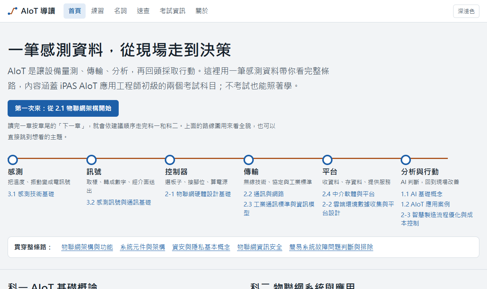
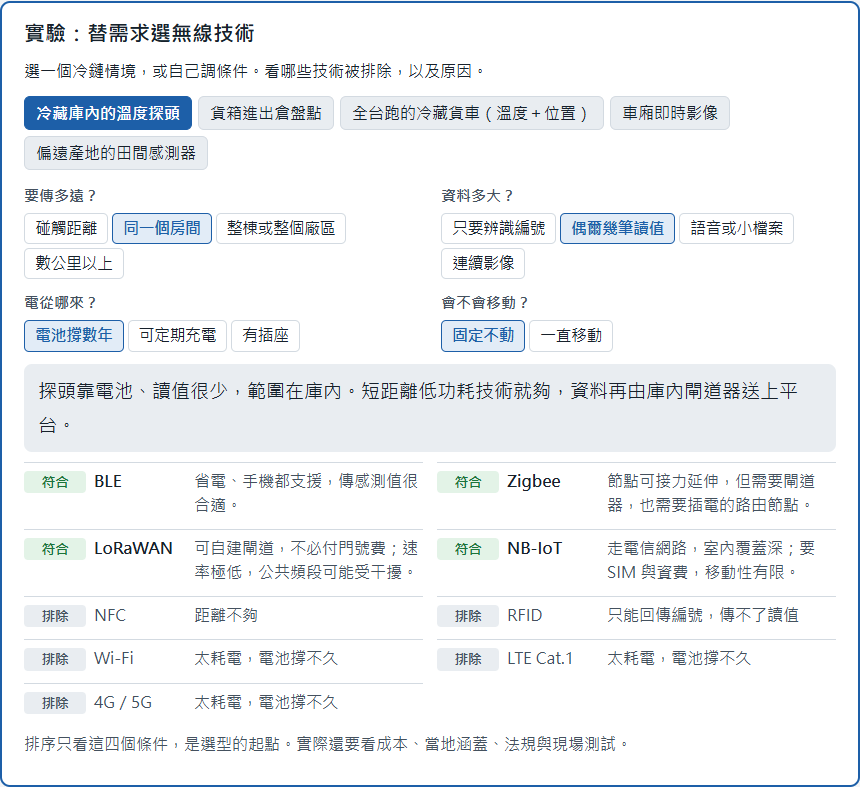
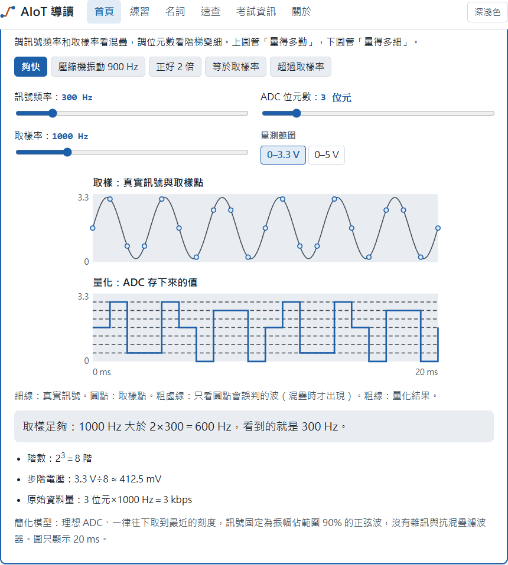
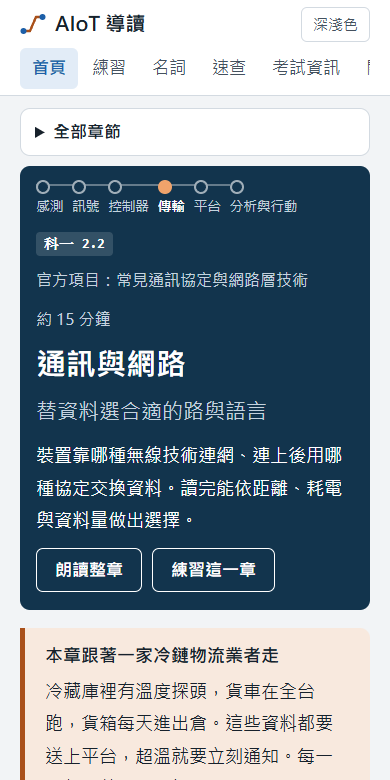
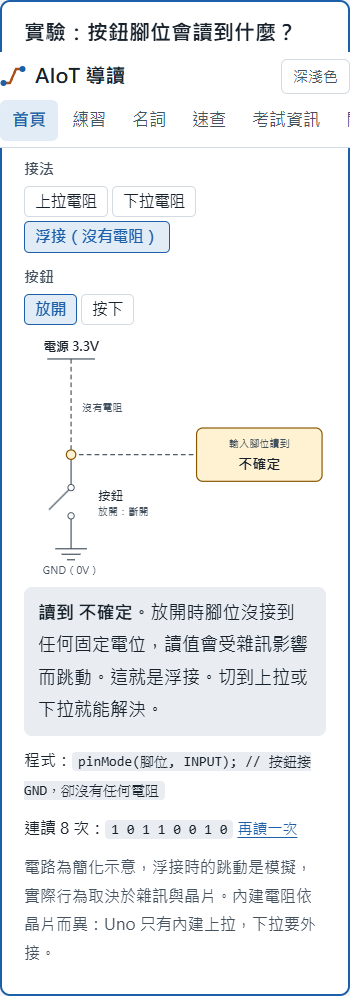

# AIoT 導讀

**感測器量到一個數字之後，要經過哪些選擇，才變成一個可以行動的決定？**

[線上閱讀](https://kuotunyu.github.io/aiot-guide/)

[](https://github.com/kuotunyu/aiot-guide/actions/workflows/quality.yml)
[](https://github.com/kuotunyu/aiot-guide/actions/workflows/link-health.yml)
[](LICENSE)
[](LICENSE-CONTENT.md)

給想學 AIoT、或正在準備 iPAS「AIoT 應用工程師（初級）」兩個學科的人的繁體中文學習網站。不需要 AI、電子或網路背景。全部內容跟著同一家冷鏈物流公司走：冷藏庫的探頭、全台跑的貨車、每天進出倉的貨箱，都要把資料送上平台。

> 本站為個人製作的非官方網站，與 iPAS、經濟部及主辦、承辦、執行單位無關，也不收錄官方歷屆試題。考試規則請以官方公告為準。



## 畫面

| 替需求選無線技術：看誰被排除、為什麼 | 取樣與 ADC：調參數看混疊與量化 |
|---|---|
|  |  |

<div align="center">
 
</div>

## 內容

15 章對應官方評鑑內容，共 25 個互動實驗、81 張圖解、8 支動畫、205 題自編練習與 267 個名詞。

| 科目 | 章 | 動手做什麼 |
|---|---|---|
| 科一 | 1.1 AI 基礎概念 | 判斷模型該放邊緣還是雲端 |
| 科一 | 1.2 AIoT 應用案例 | 調壓縮機告警門檻，比較誤報與漏報的代價 |
| 科一 | 2.1 物聯網架構與功能 | 把元件分到三層；點路徑看斷在哪一段 |
| 科一 | 2.2 通訊協定與網路技術 | 選無線技術；寫 MQTT 訂閱條件；看 QoS 遇到遺失時的行為 |
| 科一 | 2.3 工業通訊標準與資訊模型 | 比較 Modbus 暫存器與 OPC UA 節點 |
| 科一 | 2.4 中介軟體與平台 | 替資料選儲存方式；切換雲端責任分工 |
| 科一 | 2.5 資安與隱私 | 選對加密與簽章的鑰匙；把事件對應到 CIA |
| 科一 | 3.1 感測技術基礎 | 探頭打靶，分清準確度與精密度；算 Pt100 與冷接點補償 |
| 科一 | 3.2 感測訊號與通訊基礎 | 調取樣率與位元數；替連線選介面 |
| 科二 | 1-1 系統元件與架構 | 模擬貨車進隧道的暫存與補傳 |
| 科二 | 1-2 故障判斷與排除 | 自己選檢查項目，從線索推原因 |
| 科二 | 1-3 物聯網資訊安全 | 重放攻擊與不同防護的結果 |
| 科二 | 2-1 硬體設計基礎 | 上拉、下拉、浮接；估算電池續航 |
| 科二 | 2-2 雲端數據與平台 | 比較輪詢、長輪詢與 WebSocket；比較資料格式大小 |
| 科二 | 2-3 智慧製造與成本 | 拆解 OEE；算投資回收期 |

另有[練習](https://kuotunyu.github.io/aiot-guide/practice.html)、[名詞](https://kuotunyu.github.io/aiot-guide/glossary.html)、[公式與重點速查](https://kuotunyu.github.io/aiot-guide/reference.html)與[考試資訊](https://kuotunyu.github.io/aiot-guide/exam.html)。每章都能由瀏覽器語音朗讀。

## 教學設計

- **先判斷，再展開。** 每節先給一個情境題，答案預設收起。核心內容放主文，規格數字與版本演進收在可展開的區塊，但不刪除。
- **同一個案例貫穿全站。** 不用每章重新理解一個新情境，也看得出章節之間怎麼接起來。
- **實驗教取捨，不教按鈕。** 只在動手比讀文字更清楚時才做。簡化模型會在介面上明說，沒有分數、徽章或倒數。
- **不押題。** 不寫出題頻率，也不把分數當成通過機率。容易混淆的地方另外整理。
- **事實可回查。** 每章列出參考的標準與原廠文件。官方指引和通行事實不一致時，主文寫通行事實，並註明差異。

## 工程

純靜態網站：內容是 `content/` 裡的 JSON，`build.py` 用 Python 標準函式庫產生 `dist/`，瀏覽器端不用框架，也不載入任何外部資源或追蹤程式。`dist/` 可以直接雙擊開啟，影片與實驗都能離線使用。

| 檢查 | 內容 |
|---|---|
| Playwright | 桌面與手機兩種裝置，每頁無 console 錯誤、無外部請求、無橫向捲動；每個實驗實際操作 40 步；練習、名詞搜尋、朗讀、深淺色流程 |
| axe-core | 不允許 critical 與 serious 等級的無障礙問題 |
| 實驗邏輯 | 每章的純函式都有測試，數值經手算核對；MQTT 比對用規格書的範例 |
| 靜態檢查 | 內部連結與錨點、結構化資料、對比度下限、資產預算、禁用語、sitemap |
| 建置檢查 | HTML 與 SVG 規格、marker id 唯一、禁用語 |
| 外部連結 | 每週用 lychee 檢查來源是否失效 |

```bash
npm install
npx playwright install chromium
npm run check
```

已安裝 Edge 時可設定 `PW_CHANNEL=msedge` 跳過瀏覽器下載。修改內容前請讀 [AGENTS.md](AGENTS.md)。

## 與 AI 協作

內容、圖解、實驗與測試由 AI coding agent 撰寫，取捨與驗收由作者決定。每章經過獨立審查，查事實、實驗邏輯與來源。AI 仍可能出錯，發現問題歡迎[開 issue](https://github.com/kuotunyu/aiot-guide/issues)。

## 刻意不做的事

- 不收錄官方歷屆試題與官方 PDF。
- 不做帳號、進度追蹤、讀書計畫或遊戲化。
- 不引入框架、後端或第三方追蹤。

## 專案結構

```text
content/    15 章 JSON、網站設定、題庫與修訂
static/     樣式、互動程式、各章實驗、動畫、圖示
build.py    產生 dist/
scripts/    靜態檢查、測試伺服器、分享卡與截圖
tests/      各章實驗的邏輯測試、tests/e2e 瀏覽器測試
```

## 授權

程式碼採 [MIT](LICENSE)，文字、圖解、動畫與練習題採 [CC BY 4.0](LICENSE-CONTENT.md)。「iPAS」等名稱屬於其權利人，本站僅用於說明考試範圍。
