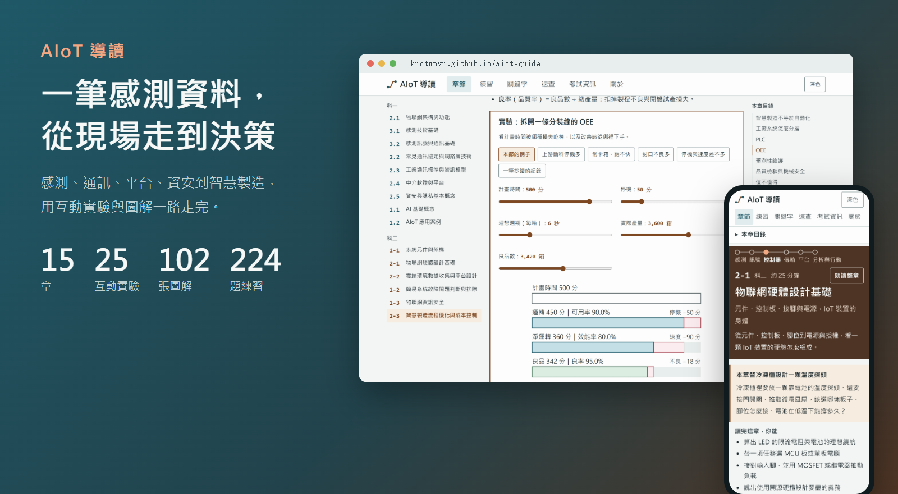
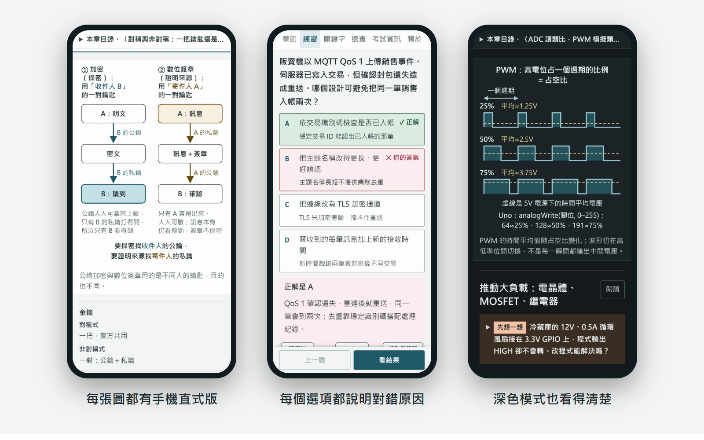

# AIoT 導讀

AIoT 的互動式學習網站，範圍對應 iPAS AIoT 應用工程師能力鑑定的兩個學科。

### [線上閱讀](https://kuotunyu.github.io/aiot-guide/)

## 內容

| 項目 | 數量 | 說明 |
|---|---|---|
| 章節 | 15 | 科目一 AIoT 基礎概論 9 章、科目二 物聯網系統與應用 6 章，章號沿用官方評鑑內容 |
| 互動實驗 | 25 | 可調參數並即時看結果，例如 OEE 三率拆解、取樣率與混疊、休眠比例與電池續航；簡化模型在介面上註明 |
| 圖解 | 102 | 含逐步圖 23 張、動畫 5 張；每張另有 360 px 寬的手機直式版 |
| 練習題 | 214 | 四選一，每個選項附一句判斷依據，答錯可連回對應章節 |
| 關鍵字 | 247 | 正文中點擊即顯示定義，並連到定義它的章節 |
| 參考來源 | 每章列出 | 標準、RFC、原廠文件等一手資料；與官方學習指引不一致處，正文寫通行事實並註明差異 |

所有章節使用同一個冷鏈物流情境：冷藏庫探頭、冷藏貨車、雲端平台與產線。

另有：整章朗讀、深色模式、手機與電腦各自的版面。網站為純靜態頁面，不需帳號，不載入外部資源或追蹤程式。

個人製作的非官方學習網站，與 iPAS 及主辦單位無關，不收錄官方試題；考試規則以官方公告為準。
